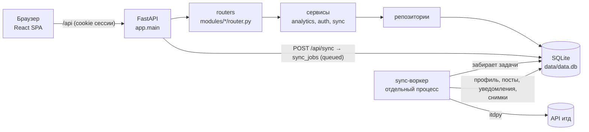

# ITD-Studio

Панель аналитики аккаунта в соцсети **итд** (`итд.com` / `xn--d1ah4a.com`).
Бэкенд — FastAPI + SQLite (SQLAlchemy 2.0, Alembic), отдельный sync-воркер ходит в итд через `itdpy`.
Фронтенд — React 19 + Vite + TypeScript, TanStack Query, react-router, Recharts.

## Быстрый старт (Windows, PowerShell)

Нужны Python 3.12+ (проверено на 3.14) и Node.js 20+.

```powershell
# 1. Бэкенд
cd backend
python -m venv venv
.\venv\Scripts\pip install -r requirements-dev.txt
copy .env.example .env          # затем впишите TOKEN_ENCRYPTION_KEY (команда генерации — в .env.example)
.\venv\Scripts\alembic upgrade head
.\venv\Scripts\uvicorn app.main:app --reload --port 8000
```

```powershell
# 2. Sync-воркер — во втором терминале (выполняет синхронизации из очереди)
cd backend
.\venv\Scripts\python -m app.modules.sync.worker
```

Для разработки можно не запускать воркер отдельно: `RUN_WORKER_IN_PROCESS=true` в `backend/.env`.

```powershell
# 3. Фронтенд — в третьем терминале
cd frontend
npm install
npm run dev                      # http://localhost:5173, /api проксируется на 127.0.0.1:8000
```

Вход: на странице входа вставьте `refresh_token` от итд. Он уходит в теле `POST /api/auth/login`,
хранится на сервере **зашифрованным** (Fernet), браузер получает только httpOnly-cookie сессии.

Тесты и проверки:

```powershell
cd backend;  .\venv\Scripts\python -m pytest --cov=app/modules/analytics
cd frontend; npm run build; npm run lint
```

## Архитектура



**Модульный монолит.** Для одного пользователя и одной SQLite настоящие микросервисы дали бы только
накладные расходы (сеть, брокер, деплой). Вместо этого — модули с жёсткими границами
(роутер → сервис → репозиторий), которые можно вынести в отдельные сервисы без переписывания.
Отдельным процессом выделен только **sync-воркер**: синхронизация долгая и ходит во внешний API.
Очередь — таблица `sync_jobs` (без брокера: для одной SQLite этого достаточно; воркер забирает задачу
атомарным `UPDATE ... WHERE status='queued'`).

Отклонения от исходного плана структуры:
- добавлены модули `notifications` (уведомления и подписки из них) и `comments` (страница «Комментарии» из дизайна);
- настройки пользователя (`/api/settings`) живут в модуле `users`;
- `app/core/timeutils.py` — единая работа со временем (всё хранится в ISO-8601 UTC);
- фабрика шлюза итд — зависимость FastAPI (`get_gateway_factory`), чтобы тесты подменяли итд без сети.

## Структура

```
backend/
├── alembic.ini                    конфиг Alembic (URL базы берётся из настроек)
├── app/
│   ├── main.py                    сборка FastAPI: create_app(), CORS, обработчики ошибок, роутеры
│   ├── api/deps.py                общие зависимости: сессия БД, текущий пользователь, фабрика шлюза итд
│   ├── core/
│   │   ├── config.py              настройки из .env (pydantic-settings), абсолютный путь к БД
│   │   ├── logging.py             логи + фильтр, вычищающий токены
│   │   ├── security.py            Fernet-шифрование refresh_token, токены сессий (в БД — только хэш)
│   │   ├── errors.py              исключения и единый формат ошибок {"error": {...}}
│   │   └── timeutils.py           разбор/формат дат, часовые пояса
│   ├── db/
│   │   ├── session.py             engine (WAL, busy_timeout), SessionLocal
│   │   ├── models.py              ORM-модели всех таблиц
│   │   └── migrations/            Alembic: 0001 — старая схема, 0002 — перенос в v2 без потери данных
│   ├── integrations/itd/client.py ЕДИНСТВЕННОЕ место с itdpy: шлюз + собственные DTO
│   └── modules/
│       ├── auth/                  вход по refresh_token (тело запроса), выход, /me
│       ├── sync/                  постановка задач (rate limit), статус, воркер, сам процесс синка
│       ├── users/                 профиль, снимки аккаунта, настройки (часовой пояс)
│       ├── posts/                 посты, снимки метрик постов, /api/posts
│       ├── notifications/         уведомления итд: хранение, follow_events, справочник itd_users,
│       │                          /api/notifications (фильтры, сортировка, сводка, авторы)
│       ├── comments/              последние комментарии и топ постов по комментариям
│       └── analytics/             overview, audience (подписчики), engagement, posting_time — чистые функции
│                                  + service.py (сбор данных) + router.py + schemas.py
├── data/                          data.db (рабочая база) и backup/ (копия базы до миграции)
├── tests/                         pytest: unit-тесты аналитики, API через TestClient, миграции, маппинг itdpy
├── requirements.txt / requirements-dev.txt
└── .env.example

frontend/                          см. frontend/README.md
```

## Переменные окружения (backend/.env)

| Переменная | По умолчанию | Назначение |
|---|---|---|
| `TOKEN_ENCRYPTION_KEY` | — (обязательна) | Ключ Fernet для шифрования refresh_token |
| `DB_URL` | `sqlite:///<backend>/data/data.db` | URL базы |
| `TIMEZONE` | `Europe/Moscow` | Пояс по умолчанию для новых пользователей (меняется в «Настройках») |
| `SYNC_COOLDOWN` | `600` | Минимум секунд между успешными синками (частые синки выбивают из итд) |
| `RUN_WORKER_IN_PROCESS` | `false` | Запускать воркер внутри API |
| `WORKER_POLL_INTERVAL` | `2` | Период опроса очереди воркером, с |
| `NOTIFICATIONS_SYNC_LIMIT` | `5000` | Максимум уведомлений за один синк |
| `CORS_ORIGINS` | `http://localhost:5173,http://127.0.0.1:5173` | Разрешённые origin (через запятую) |
| `SESSION_TTL_DAYS` | `14` | Срок жизни сессии |
| `COOKIE_SECURE` | `false` | `true` при работе по HTTPS |
| `ITD_POST_URL_TEMPLATE` | `https://xn--d1ah4a.com/@{username}/post/{post_id}` | Шаблон ссылки на пост |
| `LOG_LEVEL` | `INFO` | Уровень логов |

Фронтенд: `VITE_API_URL` (по умолчанию `/api`), см. `frontend/.env.example`.

## Откуда берётся каждая метрика и насколько она точна

| Метрика | Источник | Точность |
|---|---|---|
| Подписчики, подписки, постов (профиль) | `users.me()` при синке | Точно на момент синка |
| **Рост подписчиков — точки «снимок»** | `account_snapshots`, пишется при каждом синке | Точно, но только с момента внедрения (первый снимок — данные старой версии от 07.11.2026) |
| **Рост подписчиков — точки «уведомления»** | уведомления `follow` → `follow_events`; кривая назад от текущего числа | **Оценка**: итд не отдаёт отписки. Повторные подписки считаются один раз; ушедшие из числа подписчиков (сверка со списком подписчиков) не учитываются. Раньше самого старого уведомления точек нет |
| «+N сегодня» | `follow_events` за сегодня (в часовом поясе пользователя) | Новые подписки по уведомлениям, без учёта отписок; `null`, пока уведомления не синхронизированы |
| Просмотры, лайки, комментарии, репосты (суммы) | последние метрики постов в базе | Точно на момент синка; посты, удалённые в итд, остаются в базе |
| ER по просмотрам | (лайки + комментарии + репосты) / просмотры | Точно по формуле; это не ER «по подписчикам» |
| Метрики по дню публикации | сумма метрик постов, опубликованных в этот день | Точно, но это **не рост во времени** (подписано в UI) |
| Динамика метрик | `post_metrics_snapshots` (снимок, только если метрики поста изменились) | Точно, с момента внедрения |
| Лучшее время | средние просмотры на пост по часу публикации в поясе пользователя; час учитывается при ≥ 5 постах | Корреляция, не причинность |
| Дни недели | по дате публикации в поясе пользователя | Точно |
| Комментарии | уведомления `comment`, `reply`, `comment_mention` | Только то, что есть в истории уведомлений итд |
| Уведомления (все типы) | `notifications` итд, сохраняются инкрементально при каждом синке | Только глубина истории итд; старые уведомления, уже сохранённые в базе, не теряются |
| Верификация автора уведомления | флаг автора в уведомлении (если итд его присылает), иначе — список подписчиков (`itd_users`) | Для авторов, которых нет ни там, ни там, статус **неизвестен** (показывается отдельно, не как «не верифицирован») |
| «Прочитано» | `readAt`/`read` из уведомления на момент его первого сохранения | Позже прочитанные в итд уведомления в базе не обновляются |
| Медиа постов (фото, видео) | `attachments` поста при синке, ссылки ведут на CDN итд | Появляются после первого синка с этой версии; если итд удалит файл, ссылка перестанет работать |

Чего нет в API итд и поэтому нет в интерфейсе (показано честным пустым состоянием):
отписки и их даты, даты подписки в списке подписчиков, история подписчиков до первого снимка/уведомления,
демография аудитории.

## Безопасность

- refresh_token — только в теле `POST /api/auth/login`, никогда в URL; хранится зашифрованным.
  Итд ротирует токен при обновлении — новый токен сразу пересохраняется.
- Сессия — случайный токен в httpOnly-cookie (`SameSite=Lax`), в БД хранится только SHA-256.
- Все эндпоинты, кроме `/api/status` и `/api/auth/login`, требуют сессию; данные берутся только по пользователю из сессии.
- Синк: не чаще `SYNC_COOLDOWN`, асинхронно через очередь, клиент итд закрывается в `finally`.
- Клиенту — только общий текст ошибки; детали — в лог; фильтр логов вычищает токены.
- Выход удаляет все сессии пользователя и сохранённый refresh_token.

## Изменения API (v1 → v2)

| Было | Стало |
|---|---|
| `POST /api/sync/{refresh_token}` (синхронно) | `POST /api/auth/login` (токен в теле) + `POST /api/sync` → `202 {id}` + `GET /api/sync/{id}`, `GET /api/sync/latest` |
| — | `POST /api/auth/logout`, `GET /api/auth/me`, `GET/PUT /api/settings` |
| `GET /api/user/{username}` | `GET /api/auth/me` |
| `GET /api/user/{username}/posts` | `GET /api/posts?limit&offset&sort` |
| `GET /api/post/{id}` | удалён (не использовался фронтом) |
| `GET /api/analytics/{username}/overview` | `GET /api/analytics/overview` |
| `GET /api/analytics/{username}/growth/followers` («размазывание») | `GET /api/analytics/audience/followers` (снимки + уведомления), `GET /api/analytics/audience/new-followers` |
| `GET /api/analytics/{username}/growth/{likes,comments,reposts,views}` | `GET /api/analytics/engagement/by-publication-date` (честное название), `GET /api/analytics/engagement/dynamics` (по снимкам) |
| — | `GET /api/analytics/posting-time`, `GET /api/analytics/weekdays`, `GET /api/comments/recent`, `GET /api/comments/top-posts` |
| — | `GET /api/notifications?types&actor&verified&unread&q&date_from&date_to&sort&limit&offset`, `GET /api/notifications/summary`, `GET /api/notifications/actors?q` |
| — | `Post.attachments` (фото/видео/аудио), `GET /api/posts?media=all\|with_media\|image\|video\|text_only` |

Полный контракт со схемами — интерактивная документация `http://127.0.0.1:8000/docs`.

## Резервная копия и откат

Перед миграцией копия базы сохранена в `backend/data/backup/data.legacy-2026-11-07.db`.
Миграция 0002 необратима (`downgrade` не поддерживается): для отката верните копию базы.
